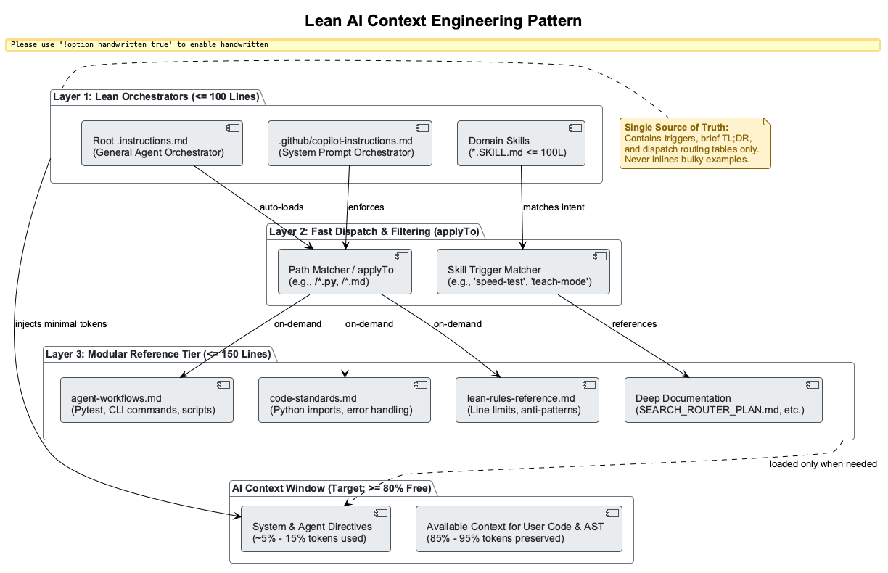

# Lean AI Principles — Skill & Instruction Authoring

> **TL;DR:** Core lean operating principles for building efficient skill and instruction files: single source of truth, SKILL.md ≤100 lines, reference files ≤150 lines, and no inline examples >20 lines.
> **Use this for:** Designing and optimizing AI instruction files and skills for minimum token bloat and maximum context efficiency.

---

## 🖼️ Architectural Pattern

*Figure 1: 3-Tier Lean AI Context Architecture — Lean Orchestrators (≤100L) dispatch via `applyTo` to focused references (≤150L), keeping ≥80% of the model context window clear for user code and AST retrieval.*

---

## Core Lean Rules (Authoritative)

### Rule 1: Line Limits
- **SKILL.md orchestrators:** ≤100 lines max
- **Reference files:** ≤150 lines max
- **Inline examples:** ≤20 lines (move longer examples to references/)

### Rule 2: Single Source Pattern
- Primary file in root (e.g., `search-fusion.instructions.md`)
- Detailed implementation in `references/implementation-guide.md`
- Cross-links between primary ↔ details
- No redundant rules in multiple files

### Rule 3: Meta-Rules for .github/ Files
- No-hooks pattern (orchestrator-based)
- Plan-first + seq-think discipline
- Dispatch pattern enforced
- Auto-apply via frontmatter `applyTo`

### Rule 4: Documentation Structure
- YAML frontmatter (title, description, shield, keywords)
- AI-SEARCHABLE-DOC-TEMPLATE compatible
- Consistent markdown formatting
- Clear section hierarchy

---

## Implementation Checklist (Pre-Commit)

- [ ] SKILL.md file ≤100 lines?
- [ ] Reference files ≤150 lines?
- [ ] Detailed examples moved to references/?
- [ ] No YAML frontmatter for skills + instructions, yes YAML frontmatter for references: present + complete?
- [ ] No redundant rules across multiple files?
- [ ] Search keywords included in frontmatter?
- [ ] Cross-links to primary ↔ detail files working?

---

## Enforcement & Automation

**Monthly audit:** Run `bloat-check` or `context-audit` skill to identify violations.

**Mechanical gates:**
- Pre-commit hook checks SKILL.md ≤100L
- CI validation on PRs to `.github/` files
- Auto-apply via frontmatter `applyTo` pattern

---

## Why Lean Matters

- **Context efficiency:** Lean files = more space for YOUR code analysis
- **Discoverability:** 100-line rules are scannable; 500-line docs get skipped
- **Maintenance:** Single source = no stale contradictions across files
- **AI coherence:** Lean principles compound — multiple small savings → 20-30% total context gain per session
