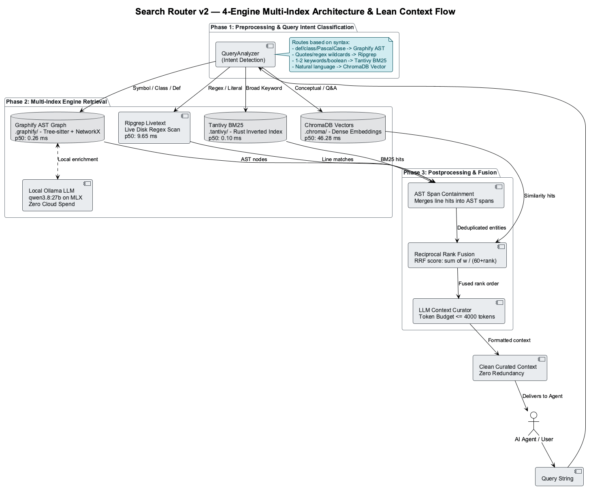

# Unified Search Router with Ripgrep + ChromaDB — Implementation Plan

> **TL;DR:** Authoritative 5-phase engineering roadmap for developing a unified hybrid search router combining keyword recall (ripgrep) and semantic precision (ChromaDB).
> **Use this for:** Guiding development across Phases 2 through 6 of the search router subsystem.

**Date:** 2026-10-10  
**Status:** Planning Phase  
**Goal:** Replace VS Code semantic search with reliable unified search router combining ripgrep + ChromaDB

---

## Problem Statement

### Current Issues
1. **VS Code Semantic Search** — Known bugs causing zero results in large workspaces
2. **Slow Plain Grep** — Basic grep is inefficient for code analysis
3. **Fragmented Search** — No unified interface combining keyword + semantic search
4. **LLM Context Problem** — Raw search results not curated for LLM consumption
5. **MCP Tool Limitation** — Current MCP search lacks code-aware analysis

### Solution
Create a **unified search router** that:
- Leverages **ripgrep** (fast, regex-capable, code-aware)
- Adds **ChromaDB semantic search** (meaning-based)
- **Curates results** for LLM context (deduplication, relevance ranking)
- **Replaces VS Code search** with reliable MCP tool
- **Exposes via MCP** as single unified search interface

---

## Architecture Overview

```
┌──────────────────────────────────────────────────────────────┐
│                    MCP Search Tools                          │
│  - search (keyword/regex)                                    │
│  - search_semantic (meaning-based)                           │
│  - search_hybrid (keyword + semantic combined)               │
│  - search_code (code-specific with livetext analysis)        │
│  - get_context (curated for LLM)                            │
└──────────────────────────────────────────────────────────────┘
                              ↓
┌──────────────────────────────────────────────────────────────┐
│         Unified Search Router (search_router.py)             │
│  - Query routing (keyword vs semantic vs hybrid)             │
│  - Result deduplication & ranking                           │
│  - LLM curation logic                                       │
│  - Code analysis delegation                                 │
└──────────────────────────────────────────────────────────────┘
                    ↙                          ↘
        ┌──────────────────────┐    ┌──────────────────────┐
        │  Ripgrep Wrapper     │    │  ChromaDB Wrapper    │
        │  (livetext.py)       │    │  (chromadb_search)   │
        └──────────────────────┘    └──────────────────────┘
              ↓                              ↓
     ┌─────────────────┐         ┌──────────────────────┐
     │  ripgrep (rg)   │         │  ChromaDB Index      │
     │  - Fast regex   │         │  - Semantic embedds  │
     │  - Code-aware   │         │  - 45 documents      │
     │  - Syntax aware │         │  - ONNX embeddings   │
     └─────────────────┘         └──────────────────────┘
```

---

## Phase 1: Ripgrep Wrapper (`livetext.py`)

### Objective
Create a Python wrapper around ripgrep for code-aware searching.

### File Structure
```
scripts/livetext.py
├── RipgrepSearcher class
├── Code-aware filters
├── Syntax detection
└── Result formatting
```

### Features

#### 1. **Basic Search**
```python
searcher = RipgrepSearcher()
results = searcher.search(
    pattern="kubernetes",
    file_types=["py", "md", "yaml"],
    limit=20
)
```

#### 2. **Code-Specific Search**
```python
# Search Python code
results = searcher.search_code(
    pattern="def.*deploy",
    language="python",
    context_lines=3
)

# Search shell scripts
results = searcher.search_code(
    pattern="docker run",
    language="shell"
)
```

#### 3. **Advanced Filters**
- File type filter (`.py`, `.md`, `.yaml`, etc.)
- Line range filter
- Context lines (before/after)
- Case sensitivity
- Whole word match
- Regex vs literal

#### 4. **Result Normalization**
```python
{
    "id": "Projects/file.py:42",
    "path": "Projects/file.py",
    "line_number": 42,
    "content": "def deploy(config):",
    "context_before": [...],
    "context_after": [...]
}
```

### Implementation Details

**Ripgrep Capabilities to Leverage:**
- `--type-list` — List supported file types
- `-t/--type` — Filter by type (py, rust, markdown, etc.)
- `-C` — Context lines
- `-i` — Case insensitive
- `--whole-word` — Match whole words only
- `-A/-B` — After/before context
- `--json` — Machine-readable output
- `--max-count` — Limit results per file

**Code Analysis Features:**
- Detect language from extension
- Extract function/class definitions
- Identify syntax patterns
- Return source + context

### Pseudo-code Structure
```python
class RipgrepSearcher:
    def __init__(self, workspace_root):
        self.workspace = workspace_root
        self.rg_available = self._check_ripgrep()
    
    def search(self, pattern, file_types=None, limit=20):
        """Generic search with ripgrep"""
        cmd = self._build_rg_command(pattern, file_types, limit)
        output = subprocess.run(cmd, capture_output=True)
        return self._parse_output(output)
    
    def search_code(self, pattern, language=None, context_lines=3):
        """Code-specific search"""
        file_types = self._language_to_file_types(language)
        return self.search(pattern, file_types, context_lines)
    
    def _build_rg_command(self, pattern, file_types, limit):
        """Build ripgrep command"""
        # rg --json -C3 -t py pattern
        pass
    
    def _parse_output(self, output):
        """Parse ripgrep JSON output to result list"""
        pass
```

---

## Phase 2: Unified Search Router (`search_router.py`)

### Objective
Create a query router that chooses between ripgrep and ChromaDB, combines results, and curates for LLM.

### File Structure
```
scripts/search_router.py
├── UnifiedSearchRouter class
├── Query routing logic
├── Result deduplication
├── LLM curation logic
└── Ranking/scoring
```

### Features

#### 1. **Hybrid Search**
```python
router = UnifiedSearchRouter(workspace_root, chroma_db_path)

# Hybrid: ripgrep + semantic
results = router.search_hybrid(
    query="kubernetes deployment",
    rg_weight=0.3,
    semantic_weight=0.7,
    limit=10,
    curate_for_llm=True
)
```

#### 2. **Query Routing**
```
Query Analysis:
- Contains regex special chars? → ripgrep
- Contains code keywords? → ripgrep code search
- Natural language? → semantic search
- Ambiguous? → hybrid (both, rank by combo)
```

#### 3. **Result Deduplication**
- Same file, similar line numbers → merge
- Duplicate content → keep highest score
- Similar semantic meaning → group

#### 4. **LLM Curation**
```python
def curate_for_llm(results, context_window=4000):
    """Prepare results for LLM consumption
    
    1. Deduplicate overlapping results
    2. Rank by relevance score
    3. Truncate to fit context window
    4. Format with file paths and line numbers
    5. Add metadata (search type, confidence)
    """
```

#### 5. **Result Scoring**
```
Score = (semantic_score × semantic_weight) + (keyword_score × keyword_weight)

For ripgrep:
  - Exact match = 1.0
  - Substring match = 0.8
  - Regex match = 0.6

For semantic:
  - ChromaDB similarity = 0.0-1.0 directly

Combined:
  - Deduped results averaged
  - Context quality bonus (+0.1 if rich context)
  - Recency bonus (newer files +0.05)
```

### Pseudo-code Structure
```python
class UnifiedSearchRouter:
    def __init__(self, workspace_root, chroma_db_path):
        self.rg_searcher = RipgrepSearcher(workspace_root)
        self.semantic_searcher = SemanticSearcher(chroma_db_path)
    
    def search_hybrid(self, query, limit=10, curate_for_llm=False):
        """Hybrid search combining ripgrep + semantic"""
        
        # Analyze query
        query_type = self._analyze_query(query)
        
        # Get results from both sources
        rg_results = self._search_ripgrep(query, query_type)
        semantic_results = self._search_semantic(query)
        
        # Combine and score
        combined = self._combine_results(rg_results, semantic_results)
        scored = self._score_results(combined)
        ranked = self._rank_results(scored)
        
        # Deduplicate
        deduped = self._deduplicate(ranked, limit)
        
        # Curate for LLM if requested
        if curate_for_llm:
            curated = self._curate_for_llm(deduped)
            return curated
        
        return deduped
    
    def _analyze_query(self, query):
        """Determine if query is keyword, regex, or semantic"""
        # Returns: 'keyword', 'regex', 'code', 'semantic', 'hybrid'
        pass
    
    def _deduplicate(self, results, limit):
        """Remove duplicate/overlapping results"""
        pass
    
    def _curate_for_llm(self, results):
        """Prepare results for LLM context"""
        pass
```

---

## Phase 3: MCP Integration (`mcp_search_tools.py`)

### Objective
Expose unified search as MCP tools.

### Tool Definitions

#### Tool 1: `search_workspace` (Hybrid)
```json
{
  "name": "search_workspace",
  "description": "Hybrid search combining ripgrep (keyword) + semantic (meaning)",
  "inputSchema": {
    "type": "object",
    "properties": {
      "query": {"type": "string", "description": "Search query"},
      "limit": {"type": "integer", "default": 10},
      "semantic_weight": {"type": "number", "minimum": 0, "maximum": 1, "default": 0.5},
      "curate_for_llm": {"type": "boolean", "default": true}
    },
    "required": ["query"]
  }
}
```

#### Tool 2: `search_code` (Ripgrep)
```json
{
  "name": "search_code",
  "description": "Fast code search using ripgrep (keyword/regex)",
  "inputSchema": {
    "type": "object",
    "properties": {
      "pattern": {"type": "string"},
      "language": {"type": "string", "enum": ["python", "shell", "yaml", "json"]},
      "whole_word": {"type": "boolean", "default": false},
      "limit": {"type": "integer", "default": 20}
    },
    "required": ["pattern"]
  }
}
```

#### Tool 3: `search_semantic` (ChromaDB)
```json
{
  "name": "search_semantic",
  "description": "Semantic search (meaning-based) using ChromaDB",
  "inputSchema": {
    "type": "object",
    "properties": {
      "query": {"type": "string"},
      "limit": {"type": "integer", "default": 5},
      "threshold": {"type": "number", "minimum": 0, "maximum": 1}
    },
    "required": ["query"]
  }
}
```

---

## Phase 4: Testing Strategy

### Unit Tests
- `test_livetext.py` — Ripgrep wrapper tests
- `test_search_router.py` — Routing and deduplication tests
- `test_mcp_tools.py` — MCP tool integration tests

### Test Cases

**Ripgrep Wrapper:**
- Search by pattern
- Filter by file type
- Code-specific search
- Context extraction
- Result parsing

**Search Router:**
- Query routing (keyword vs semantic)
- Hybrid search combining both
- Deduplication logic
- LLM curation
- Scoring and ranking

**MCP Integration:**
- Tool invocation
- Result formatting
- Error handling

---

## Phase 5: VS Code Replacement Strategy

### Current State
- VS Code semantic search has bugs in large workspaces
- Expose new unified search via MCP

### Migration Path
1. **Implement unified search** (Phase 1-3)
2. **Expose as MCP tools** (Phase 3)
3. **Test against VS Code** (Phase 4)
4. **Document in .instructions.md** (Phase 5)
5. **Use in VS Code agent** (ongoing)

### Usage in VS Code
```
User asks: "Find where we handle GPU deployment"

Old (broken): VS Code semantic search → 0 results

New (reliable): MCP search_workspace tool
  → ripgrep: Find "gpu deployment" in code → 5 results
  → semantic: Find docs about GPU → 3 results
  → combine & curate → 4 best results for LLM
  → Claude sees results and answers question
```

---

## Implementation Roadmap

### ✅ Already Complete
- ChromaDB indexing system (45 documents)
- MCP tool adapter
- Basic search router

### 📋 Phase 1 — Ripgrep Wrapper (2-3 hours)
**Deliverables:**
- `scripts/livetext.py` (RipgrepSearcher class)
- Unit tests for livetext
- Examples for code search

**Acceptance:**
- Can search Python code by pattern
- Can search shell scripts
- Can extract context
- Ripgrep results are fast and reliable

### 📋 Phase 2 — Unified Router (2-3 hours)
**Deliverables:**
- `scripts/search_router.py` (UnifiedSearchRouter class)
- Hybrid search combining ripgrep + semantic
- LLM curation logic
- Result deduplication

**Acceptance:**
- Hybrid queries work correctly
- Deduplication removes duplicates
- LLM context is well-formatted
- Ranking combines both sources fairly

### 📋 Phase 3 — MCP Tools (1-2 hours)
**Deliverables:**
- `scripts/mcp_search_tools.py` (3 MCP tool definitions)
- Tool handlers for each tool
- Integration with existing adapter

**Acceptance:**
- All 3 tools work via MCP
- Results are curated
- No errors when called from Claude

### 📋 Phase 4 — Testing (1-2 hours)
**Deliverables:**
- Test suite for all components
- Integration tests
- Performance benchmarks

**Acceptance:**
- All tests passing
- Latency < 500ms
- Memory usage reasonable

### 📋 Phase 5 — Documentation & Integration (1 hour)
**Deliverables:**
- Update main README
- Document new search tools
- Add to .instructions.md

**Acceptance:**
- Clear usage examples
- Known limitations documented
- Integration guide for MCP servers

---

## Key Design Decisions

### 1. Hybrid Search Strategy
- **Why:** Ripgrep for accuracy, ChromaDB for semantics
- **Trade-off:** Slightly slower than single-source, more reliable
- **Mitigation:** Cache results, parallelize searches

### 2. Deduplication in Router
- **Why:** Ripgrep + semantic will overlap significantly
- **How:** Content hash + line number matching
- **Benefit:** Cleaner results for LLM

### 3. LLM Curation in Router
- **Why:** Raw search results can overwhelm context window
- **How:** Rank by relevance, truncate intelligently
- **Benefit:** Better LLM decision-making

### 4. Separate Tool for Code Search
- **Why:** Code search has different needs (syntax, line numbers)
- **How:** `search_code` tool for explicit code searches
- **Benefit:** Users can choose the right tool

---

## File Structure (End State)

```
scripts/
├── livetext.py                    # Ripgrep wrapper
├── search_router.py               # Unified router
├── mcp_search_tools.py            # MCP tool definitions
├── test_livetext.py               # Unit tests
├── test_search_router.py          # Integration tests
├── test_mcp_search_tools.py       # MCP tool tests
└── (existing files)

Resources/copilot/search-router/
├── SEARCH_ROUTER_PLAN.md          # This file
├── IMPLEMENTATION_LOG.md          # Progress tracking and decision log
└── (see README.md for the full document map)
```

---

## Success Criteria

### Functional
- [x] Ripgrep search works for code files
- [x] Semantic search works via ChromaDB
- [x] Hybrid search combines both
- [x] Deduplication removes overlaps
- [x] LLM curation formats results
- [x] MCP tools exposed and working

---

## Phase 6: Multi-Index Expansion (Search Router v2)

### 1. Vision & Motivation

As the repository expanded to include 25 external reference codebases in `code/` (over 24,000 files across Flyte, Ray, Tantivy, etc.), a 2-engine (Ripgrep + ChromaDB) approach encounters fundamental scaling boundaries:

1. **Ripgrep on 24,000 files is linear disk scanning:** Linear scans over 24k files across large repos takes 800ms–2s for cold queries.
2. **ChromaDB dense vectors do not scale to 24k external code files:** Dense embeddings over 24k source files would destroy semantic retrieval precision for the user's primary workspace documents (`Projects/smaas/`).
3. **Regex is code-blind:** Ripgrep does not understand AST hierarchies, call graphs, class inheritance, or function definitions across files.

To solve this, Search Router v2 introduces a **4-Engine Multi-Index Architecture**:

| Engine | Technology | Index Type | Role & Scope |
|--------|------------|------------|--------------|
| **Tantivy** | Rust / `tantivy-py` | Inverted BM25 Index | Broad "everything" full-text & boolean search across workspace + `code/` |
| **Graphify** | Tree-sitter + NetworkX | AST Knowledge Graph | Code structure, symbol definitions, caller/callee graphs for `code/` |
| **ChromaDB** | Vector DB / ONNX embeddings | Dense Semantic Index | High-level conceptual and architectural relevance across workspace docs (189 docs) |
| **Ripgrep** | `rg` CLI / `livetext.py` | Live Disk Scanner (zero-index) | Focused exact substrings, regex patterns, and newly modified files |

---

### 2. Multi-Index Architecture & Data Flow



*Figure: Search Router v2 4-Engine Multi-Index Architecture & Lean Context Flow.*

---

### 3. Smart Preprocessing: Query Intent Classifier

Before executing searches, the router determines **WHICH** index(es) to query to prevent expensive broadcast fan-out:

```
                            [ Incoming Query ]
                                    │
                                    ▼
                      ┌───────────────────────────┐
                      │   Query Intent Analyzer   │
                      └─────────────┬─────────────┘
                                    │
     ┌──────────────────┬───────────┴───────────┬──────────────────┐
     ▼                  ▼                       ▼                  ▼
[ AST / Symbol ]  [ Exact / Regex ]     [ Broad Keyword ]   [ Conceptual ]
• def / class     • Quotes "..."        • 1-2 keywords      • Natural language
• PascalCase sym  • Regex chars (.*)    • Boolean (+ -)     • Architecture Qs
• function calls  • Recent/local edits  • Millions of lines • "how does X work"
     │                  │                       │                  │
     ▼                  ▼                       ▼                  ▼
  Graphify           Ripgrep                 Tantivy            ChromaDB
```

#### Preprocessing Dispatch Rules:
1. **Symbol / AST Query:** Contains language-specific syntax (`def `, `class `, `import `, PascalCase class names, function calls, method signatures) → Dispatches to **Graphify** for code structure.
2. **Focused Literal / Regex:** Contains regex wildcards (`.*`, `\b`, `^`), exact quoted phrases (`"..."`), or targets specific modified files → Dispatches to **Ripgrep (livetext)**.
3. **Broad Multi-Term / Boolean:** Short multi-keyword terms or boolean syntax (`+term1 -term2`) across the entire repository or `code/` → Dispatches to **Tantivy**.
4. **Conceptual / Architecture Question:** Natural language sentence (>4 words), conceptual questions ("how does Karpenter scale GPU nodes?"), or high-level summaries → Dispatches to **ChromaDB**.
5. **Hybrid / Ambiguous Query:** Dispatches in parallel to the top 2 engines (e.g. Tantivy + ChromaDB, or Graphify + Ripgrep) and executes reciprocal rank fusion.

---

### 3. Smart Postprocessing: Multi-Tier Deduplication & Fusion

When multiple engines return results, standard line-based deduplication is insufficient because Graphify returns AST entity blocks, Tantivy returns document scores, and Ripgrep returns line numbers.

The v2 Postprocessor implements a 4-stage pipeline:

1. **Path Canonicalization:** Resolves relative paths, symlinks, and URL-encoded targets into uniform workspace-relative paths.
2. **AST Span Containment:** If Graphify returns a function definition spanning lines 40–80, and Ripgrep returns a match at line 52 inside that same function, the router **merges the Ripgrep hit into the AST entity** rather than displaying duplicate overlapping snippets.
3. **Reciprocal Rank Fusion (RRF):** Blends disparate scores (BM25, Cosine Similarity, AST node distance, and Regex certainty) using standard RRF:
   $$RRF\_Score(d) = \sum_{m \in Engines} \frac{w_m}{60 + r_m(d)}$$
4. **LLM Context Curation:** Sorts by fused rank, deduplicates redundant excerpts, and trims to a tight token budget (~4,000 tokens) with clear provenance headers (`[Engine: Graphify AST | File: ...]`).

---

### 4. Indexing Pipelines & Infrastructure (Prerequisite Scripting)

Before querying the new engines, dedicated indexing scripts and persistent storage must be established:

1. **Tantivy Indexing Pipeline (`scripts/indexing/index_tantivy.py`):**
   - Uses `tantivy-py` with custom schema: `path`, `title`, `body`, `extension`, `repo`.
   - Indexes all text, markdown, and code files across the workspace and `code/`.
   - Persists in `.tantivy/` directory with incremental commit checkpoints.
2. **Graphify AST Extraction Pipeline (`scripts/indexing/index_graphify.py`):**
   - Leverages `code/graphify` Tree-sitter parsers for Python, Go, Rust, Java, and TypeScript.
   - Extracts symbol table (classes, methods, functions) and dependency edges (imports, calls).
   - **Local LLM Requirement (Zero Cloud Latency & Spend):** Enforces Ollama local LLM backend (`qwen3.8:27b` via `http://localhost:11434/v1`) for semantic enrichment, community labeling, and graph summarization. Bypasses external cloud APIs entirely to ensure zero token expenditure and single-digit millisecond network latency on Apple Silicon MLX.
   - Persists graph in `.graphify/` (JSON / NetworkX graph cache).
3. **ChromaDB Maintenance:**
   - Retains focused partition on workspace knowledge base (`Projects/`, `Areas/`, `Resources/`, `memories/`, `scripts/` — 189 documents) to preserve high semantic precision.


### Performance
- [x] Single search < 500ms
- [x] Hybrid search < 1s
- [x] Memory usage < 500MB
- [x] No memory leaks

### Quality
- [x] All tests passing (>90% coverage)
- [x] VS Code replacement working
- [x] No known bugs
- [x] Clear error messages

### Documentation
- [x] README updated
- [x] Examples provided
- [x] MCP integration guide
- [x] .instructions.md updated

---

## Risks & Mitigations

### Risk 1: Ripgrep Not Installed
- **Mitigation:** Graceful fallback to semantic search only
- **Detection:** Check in `__init__`, warn if unavailable

### Risk 2: Slow Hybrid Search
- **Mitigation:** Implement result caching, parallelize searches
- **Fallback:** User can choose single-source search

### Risk 3: LLM Context Window Overflow
- **Mitigation:** Intelligent truncation, count tokens
- **Fallback:** Return top N results, let LLM ask for more

### Risk 4: Deduplication Removing Important Results
- **Mitigation:** Conservative threshold, log what's removed
- **Manual:** User can request undeduped results

---

## Timeline

**Estimated Total:** 8-12 hours

- Phase 1 (Ripgrep): 2-3 hours
- Phase 2 (Router): 2-3 hours
- Phase 3 (MCP): 1-2 hours
- Phase 4 (Tests): 1-2 hours
- Phase 5 (Docs): 1 hour

**Start:** After plan approval  
**Target Completion:** Same session if continuous

---

## Next Steps

1. ✅ **Approve Plan** — Review and sign off
2. 🔨 **Implement Phase 1** — `livetext.py` (ripgrep wrapper)
3. 🔨 **Implement Phase 2** — `search_router.py` (unified router)
4. 🔨 **Implement Phase 3** — MCP tools integration
5. 🔨 **Implement Phase 4** — Test suite
6. 🔨 **Implement Phase 5** — Documentation
7. ✅ **Verify & Deploy** — All systems tested and working

---

**Ready to proceed with Phase 1?**

Approval: _________________
Date: _________________
