# Mermaid Language Reference Guide

> **TL;DR:** Complete syntax guide and example library covering every Mermaid diagram type (flowcharts, sequence diagrams, class diagrams, ERDs, mindmaps, and Gantt charts).
> **Use this for:** Authoring clean architectural and workflow diagrams in Markdown.

## Table of Contents

1. [Overview](#overview)
2. [Core Diagrams](#core-diagrams)
   - [Flowchart](#1-flowchart)
   - [Sequence Diagram](#2-sequence-diagram)
   - [Class Diagram](#3-class-diagram)
   - [State Diagram](#4-state-diagram)
   - [Entity Relationship Diagram](#5-entity-relationship-diagram-erd)
   - [User Journey](#6-user-journey)
   - [Gantt Chart](#7-gantt-chart)
   - [Pie Chart](#8-pie-chart)
   - [Quadrant Chart](#9-quadrant-chart)
   - [Requirement Diagram](#10-requirement-diagram)
   - [GitGraph](#11-gitgraph)
   - [C4 Diagram](#12-c4-diagram)
   - [Mindmap](#13-mindmap)
   - [Timeline](#14-timeline)
   - [ZenUML](#15-zenuml)
3. [New Diagrams 🔥](#new-diagrams-)
   - [Sankey](#16-sankey-)
   - [XY Chart](#17-xy-chart-)
   - [Block Diagram](#18-block-diagram-)
   - [Packet](#19-packet-)
   - [Kanban](#20-kanban-)
   - [Architecture](#21-architecture-)
   - [Radar](#22-radar-)
   - [Treemap](#23-treemap-)
   - [Venn](#24-venn-)
   - [Ishikawa](#25-ishikawa-)
   - [TreeView](#26-treeview-)
4. [Configuration & Theming](#configuration--theming)
5. [Common Syntax Elements](#common-syntax-elements)

---

## Overview

Mermaid is a JavaScript-based diagramming and charting tool that renders Markdown-inspired text definitions to create diagrams dynamically. It supports 26+ diagram types.

### Basic Structure

All Mermaid diagrams start with a diagram type declaration:

```mermaid
<diagramType>
    <diagram definition>
```

### Frontmatter Configuration

```mermaid
---
title: Diagram Title
config:
  theme: forest
  look: handDrawn
---
<diagramType>
    ...
```

### Comments

```mermaid
%% This is a comment - ignored by parser
```

---

## Core Diagrams

### 1. Flowchart

**Declaration:** `flowchart` or `graph`

**Direction:**
- `TB` / `TD` - Top to Bottom
- `BT` - Bottom to Top
- `LR` - Left to Right
- `RL` - Right to Left

#### Node Shapes

| Syntax | Shape |
|--------|-------|
| `id[text]` | Rectangle |
| `id(text)` | Rounded Rectangle |
| `id([text])` | Stadium |
| `id[[text]]` | Subroutine |
| `id[(text)]` | Cylinder/Database |
| `id((text))` | Circle |
| `id>text]` | Asymmetric |
| `id{text}` | Diamond/Rhombus |
| `id{{text}}` | Hexagon |
| `id[/text/]` | Parallelogram |
| `id[\text\]` | Parallelogram Alt |
| `id[/text\]` | Trapezoid |
| `id[\text/]` | Trapezoid Alt |
| `id(((text)))` | Double Circle |

#### New Shape Syntax (v11.3.0+)

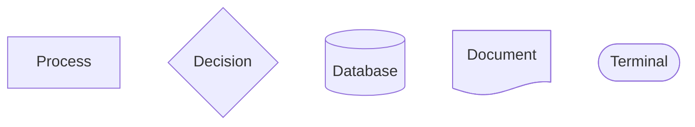

**Available shapes:** `rect`, `rounded`, `stadium`, `cyl`, `circle`, `diamond`, `hex`, `lean-r`, `lean-l`, `trap-b`, `trap-t`, `dbl-circ`, `notch-rect`, `lin-rect`, `f-circ`, `fr-circ`, `fork`, `hourglass`, `brace`, `brace-r`, `braces`, `bolt`, `doc`, `delay`, `das`, `lin-cyl`, `curv-trap`, `div-rect`, `tri`, `win-pane`, `lin-doc`, `notch-pent`, `flip-tri`, `sl-rect`, `docs`, `processes`, `odd`, `flag`, `bow-rect`, `cross-circ`, `tag-doc`, `tag-rect`, `text`, `cloud`, `sm-circ`

#### Links/Edges

| Syntax | Description |
|--------|-------------|
| `-->` | Arrow |
| `---` | Open link |
| `-.->` | Dotted arrow |
| `-.-` | Dotted link |
| `==>` | Thick arrow |
| `===` | Thick link |
| `~~~` | Invisible link |
| `--o` | Circle end |
| `--x` | Cross end |
| `o--o` | Circle both ends |
| `<-->` | Bidirectional |
| `x--x` | Cross both ends |

**Link with text:**
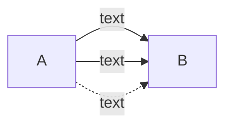

**Link length:** Add extra dashes (`--->`, `---->`) for longer links.

#### Subgraphs

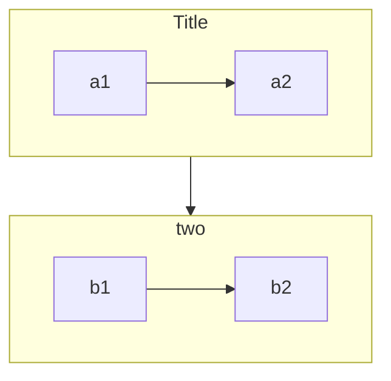

#### Styling

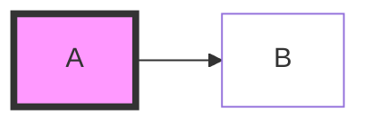

**Link styling:**
```mermaid
linkStyle 0 stroke:#ff3,stroke-width:4px
linkStyle default stroke:#333
```

#### Example

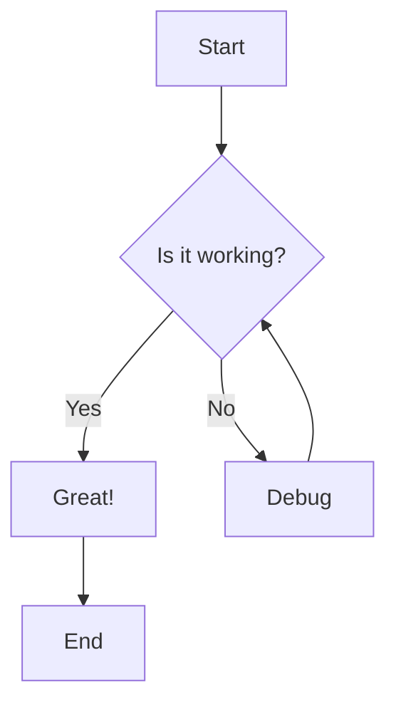

---

### 2. Sequence Diagram

**Declaration:** `sequenceDiagram`

#### Participants

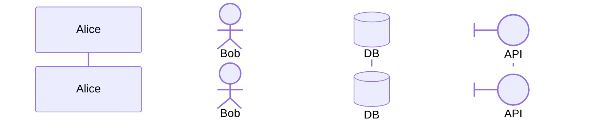

**Participant types:** `participant`, `actor`, `boundary`, `control`, `entity`, `database`, `collections`, `queue`

#### Messages/Arrows

| Syntax | Description |
|--------|-------------|
| `->` | Solid line, no arrow |
| `-->` | Dotted line, no arrow |
| `->>` | Solid line with arrowhead |
| `-->>` | Dotted line with arrowhead |
| `<<->>` | Bidirectional solid (v11.0.0+) |
| `<<-->>` | Bidirectional dotted (v11.0.0+) |
| `-x` | Solid with cross |
| `--x` | Dotted with cross |
| `-)` | Solid with open arrow (async) |
| `--)` | Dotted with open arrow (async) |

#### Activations

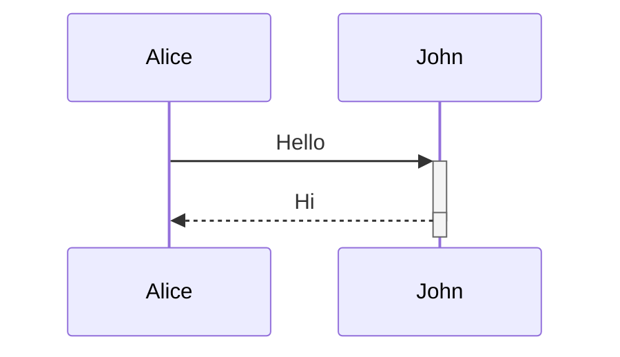

#### Control Flow

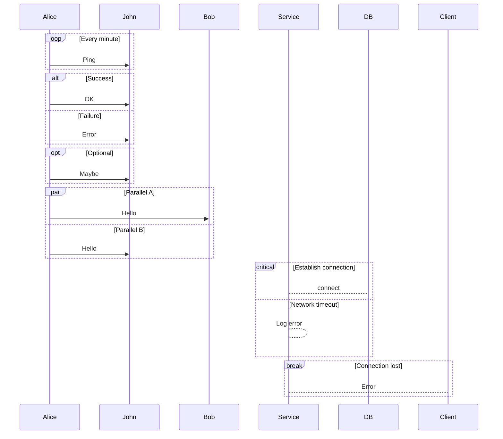

#### Notes

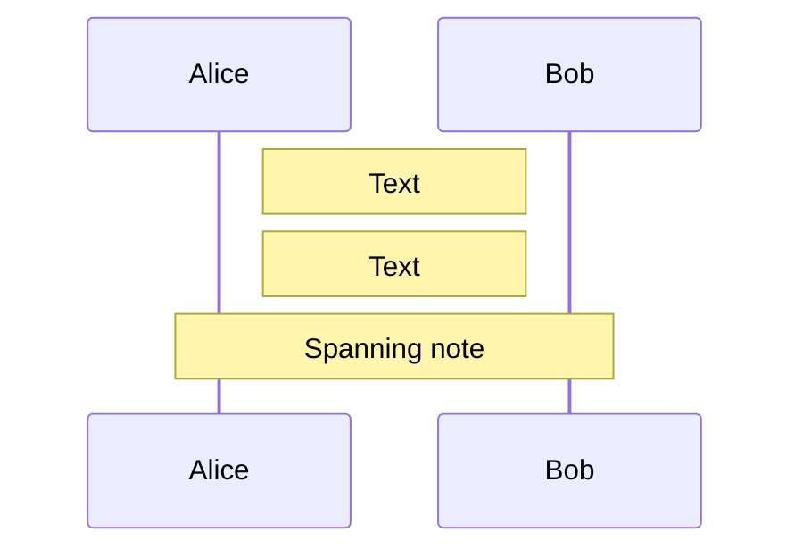

#### Boxes/Groups

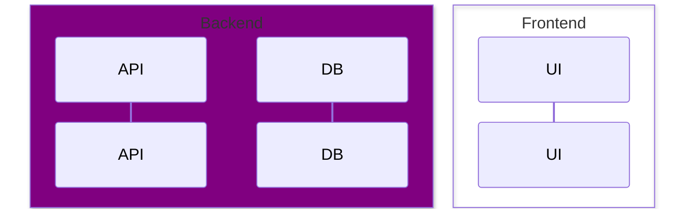

#### Background Highlighting

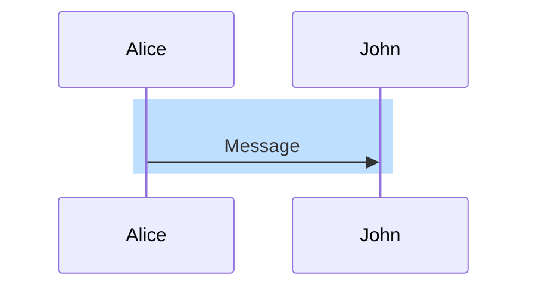

#### Auto-numbering

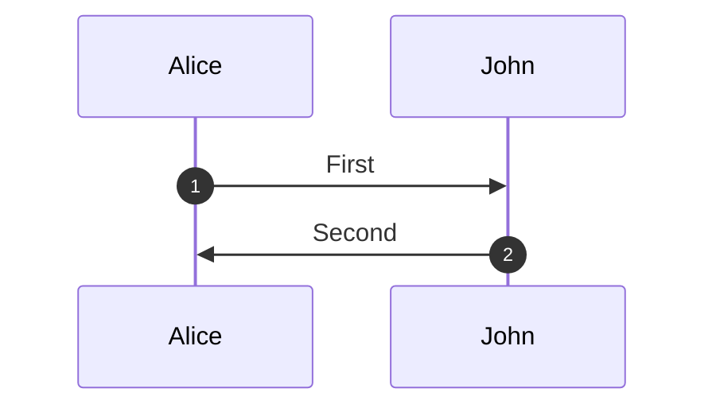

#### Actor Creation/Destruction (v10.3.0+)

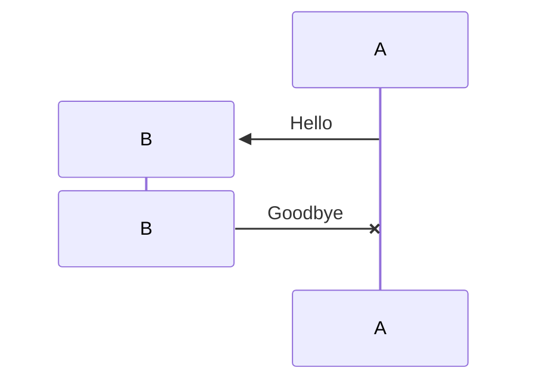

#### Example

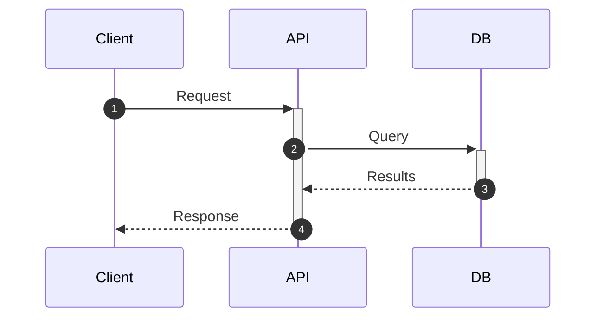

---

### 3. Class Diagram

**Declaration:** `classDiagram`

#### Class Definition

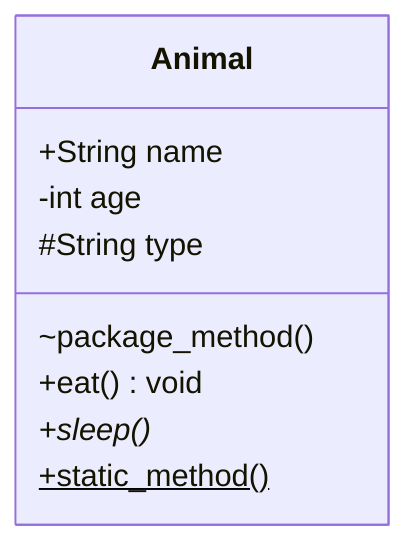

**Visibility:**
- `+` Public
- `-` Private
- `#` Protected
- `~` Package/Internal

**Modifiers:**
- `*` Abstract
- `$` Static

#### Relationships

| Syntax | Description |
|--------|-------------|
| `<\|--` | Inheritance |
| `*--` | Composition |
| `o--` | Aggregation |
| `-->` | Association |
| `--` | Link (Solid) |
| `..>` | Dependency |
| `..\|>` | Realization |
| `..` | Link (Dashed) |
| `<\|..\|>` | Bidirectional |
| `()--` | Lollipop interface |

#### Cardinality

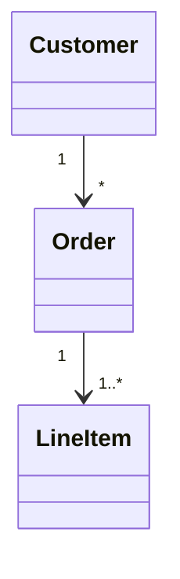

**Cardinality values:** `1`, `0..1`, `1..*`, `*`, `n`, `0..n`, `1..n`

#### Annotations

```mermaid
classDiagram
    class Shape {
        <<interface>>
    }
    class Color {
        <<enumeration>>
        RED
        GREEN
        BLUE
    }
    class AbstractClass {
        <<abstract>>
    }
    class MyService {
        <<service>>
    }
```

#### Namespaces

```mermaid
classDiagram
    namespace BaseShapes {
        class Triangle
        class Rectangle
    }
```

#### Direction

```mermaid
classDiagram
    direction RL
```

#### Generics

```mermaid
classDiagram
    class List~T~ {
        +add(T item)
        +get(int index) T
    }
```

#### Example

```mermaid
classDiagram
    Animal <|-- Duck
    Animal <|-- Fish
    Animal : +int age
    Animal : +String gender
    Animal: +isMammal() bool
    
    class Duck {
        +String beakColor
        +swim()
        +quack()
    }
```

---

### 4. State Diagram

**Declaration:** `stateDiagram-v2` or `stateDiagram`

#### States

```mermaid
stateDiagram-v2
    [*] --> Still
    Still --> [*]
    Still --> Moving
    Moving --> Still
    Moving --> Crash
    Crash --> [*]
```

**Special states:**
- `[*]` - Start/End state

#### State with Description

```mermaid
stateDiagram-v2
    state "This is a description" as s1
    s2 : Another description
```

#### Transitions

```mermaid
stateDiagram-v2
    s1 --> s2: A transition
```

#### Composite States

```mermaid
stateDiagram-v2
    [*] --> First
    state First {
        [*] --> second
        second --> [*]
    }
```

#### Choice

```mermaid
stateDiagram-v2
    state if_state <<choice>>
    [*] --> IsPositive
    IsPositive --> if_state
    if_state --> False: if n < 0
    if_state --> True: if n >= 0
```

#### Fork/Join

```mermaid
stateDiagram-v2
    state fork_state <<fork>>
    state join_state <<join>>
    [*] --> fork_state
    fork_state --> State2
    fork_state --> State3
    State2 --> join_state
    State3 --> join_state
    join_state --> [*]
```

#### Concurrency

```mermaid
stateDiagram-v2
    state Active {
        [*] --> NumLockOff
        NumLockOff --> NumLockOn: EvNumLockPressed
        --
        [*] --> CapsLockOff
        CapsLockOff --> CapsLockOn: EvCapsLockPressed
    }
```

#### Notes

```mermaid
stateDiagram-v2
    State1: The state
    note right of State1: Note text
    note left of State2: Another note
```

#### Direction

```mermaid
stateDiagram
    direction LR
```

#### Styling

```mermaid
stateDiagram-v2
    classDef movement font-style:italic
    classDef badEvent fill:#f00,color:white
    
    Still:::notMoving --> Moving:::movement
    class Crash badEvent
```

#### Example

```mermaid
stateDiagram-v2
    [*] --> Idle
    Idle --> Processing: Start
    Processing --> Complete: Success
    Processing --> Error: Failure
    Error --> Idle: Reset
    Complete --> [*]
```

---

### 5. Entity Relationship Diagram (ERD)

**Declaration:** `erDiagram`

#### Entities and Relationships

```mermaid
erDiagram
    CUSTOMER ||--o{ ORDER : places
    ORDER ||--|{ LINE-ITEM : contains
```

#### Cardinality Notation (Crow's Foot)

| Left | Right | Meaning |
|------|-------|---------|
| `\|o` | `o\|` | Zero or one |
| `\|\|` | `\|\|` | Exactly one |
| `}o` | `o{` | Zero or more |
| `}\|` | `\|{` | One or more |

**Aliases:**
- `one or zero`, `zero or one`, `0..1`
- `one or more`, `one or many`, `many(1)`, `1+`
- `zero or more`, `zero or many`, `many(0)`, `0+`
- `only one`, `1`

#### Identification

| Syntax | Description |
|--------|-------------|
| `--` | Identifying (solid line) |
| `..` | Non-identifying (dashed line) |

**Aliases:** `to` (identifying), `optionally to` (non-identifying)

#### Attributes

```mermaid
erDiagram
    CUSTOMER {
        string name PK
        string email UK
        int age
    }
    ORDER {
        int orderNumber PK
        string deliveryAddress
        date orderDate
    }
    LINE-ITEM {
        string productCode PK,FK
        int quantity
        float pricePerUnit "Unit price"
    }
```

**Key types:** `PK` (Primary Key), `FK` (Foreign Key), `UK` (Unique Key)

#### Entity Aliases

```mermaid
erDiagram
    p[Person] {
        string name
    }
    a["Customer Account"] {
        string email
    }
    p ||--o| a : has
```

#### Direction

```mermaid
erDiagram
    direction LR
```

**Directions:** `TB`, `BT`, `LR`, `RL`

#### Example

```mermaid
erDiagram
    CUSTOMER ||--o{ ORDER : places
    CUSTOMER {
        string name
        string custNumber PK
        string sector
    }
    ORDER ||--|{ LINE-ITEM : contains
    ORDER {
        int orderNumber PK
        string deliveryAddress
    }
    LINE-ITEM {
        string productCode PK,FK
        int quantity
        float pricePerUnit
    }
```

---

### 6. User Journey

**Declaration:** `journey`

#### Syntax

```mermaid
journey
    title My working day
    section Go to work
        Make tea: 5: Me
        Go upstairs: 3: Me
        Do work: 1: Me, Cat
    section Go home
        Go downstairs: 5: Me
        Sit down: 5: Me
```

**Task syntax:** `Task name: <score>: <comma separated actors>`

**Score:** 1-5 (1 = bad, 5 = good)

---

### 7. Gantt Chart

**Declaration:** `gantt`

#### Basic Syntax

```mermaid
gantt
    title A Gantt Diagram
    dateFormat YYYY-MM-DD
    
    section Section
    A task           :a1, 2024-01-01, 30d
    Another task     :after a1, 20d
```

#### Date Formats

**Input (`dateFormat`):** `YYYY-MM-DD`, `DD-MM-YYYY`, `YYYY-MM-DD HH:mm`, etc.

**Output (`axisFormat`):** `%Y-%m-%d`, `%d/%m`, `%H:%M`, etc.

#### Task Attributes

| Tag | Description |
|-----|-------------|
| `done` | Completed task |
| `active` | Currently active |
| `crit` | Critical path |
| `milestone` | Milestone marker |
| `vert` | Vertical marker (v11+) |

#### Task Syntax

```mermaid
gantt
    Completed task    :done,    des1, 2024-01-01, 2024-01-05
    Active task       :active,  des2, 2024-01-06, 3d
    Critical task     :crit,    des3, after des2, 5d
    Future task       :         des4, after des3, 5d
    Milestone         :milestone, m1, 2024-01-20, 0d
```

#### Duration Units

`ms` (milliseconds), `s` (seconds), `m` (minutes), `h` (hours), `d` (days), `w` (weeks), `M` (months), `y` (years)

#### Dependencies

```mermaid
gantt
    Task A    :a, 2024-01-01, 30d
    Task B    :b, after a, 20d
    Task C    :c, after a b, 10d
    Task D    :d, 2024-01-01, until b
```

#### Excludes

```mermaid
gantt
    excludes weekends
    excludes 2024-01-15
    weekend friday
```

#### Sections

```mermaid
gantt
    section Development
    Task A :a1, 2024-01-01, 30d
    section Testing
    Task B :after a1, 20d
```

#### Compact Mode

```yaml
---
displayMode: compact
---
gantt
    ...
```

#### Today Marker

```mermaid
gantt
    todayMarker stroke-width:5px,stroke:#0f0
    %% Or hide:
    todayMarker off
```

#### Tick Interval

```mermaid
gantt
    tickInterval 1week
    weekday monday
```

---

### 8. Pie Chart

**Declaration:** `pie`

```mermaid
pie title Pets adopted by volunteers
    "Dogs" : 386
    "Cats" : 85
    "Rats" : 15
```

#### Show Data Values

```mermaid
pie showData
    title Key Elements
    "Calcium" : 42.96
    "Potassium" : 50.05
    "Magnesium" : 10.01
```

#### Configuration

```yaml
---
config:
  pie:
    textPosition: 0.5
  themeVariables:
    pieOuterStrokeWidth: "5px"
---
```

---

### 9. Quadrant Chart

**Declaration:** `quadrantChart`

```mermaid
quadrantChart
    title Reach and engagement of campaigns
    x-axis Low Reach --> High Reach
    y-axis Low Engagement --> High Engagement
    quadrant-1 We should expand
    quadrant-2 Need to promote
    quadrant-3 Re-evaluate
    quadrant-4 May be improved
    Campaign A: [0.3, 0.6]
    Campaign B: [0.45, 0.23]
    Campaign C: [0.57, 0.69]
```

**Point coordinates:** `[x, y]` where x and y are 0-1

#### Point Styling

```mermaid
quadrantChart
    Point A: [0.9, 0.0] radius: 12
    Point B:::class1: [0.8, 0.1] color: #ff3300, radius: 10
    classDef class1 color: #109060
```

**Style properties:** `color`, `radius`, `stroke-width`, `stroke-color`

---

### 10. Requirement Diagram

**Declaration:** `requirementDiagram`

```mermaid
requirementDiagram
    requirement test_req {
        id: 1
        text: the test text
        risk: high
        verifymethod: test
    }
    
    functionalRequirement test_req2 {
        id: 1.1
        text: functional requirement
        risk: low
        verifymethod: inspection
    }
    
    element test_entity {
        type: simulation
    }
    
    test_entity - satisfies -> test_req2
    test_req - traces -> test_req2
```

#### Requirement Types

`requirement`, `functionalRequirement`, `interfaceRequirement`, `performanceRequirement`, `physicalRequirement`, `designConstraint`

#### Risk Levels

`low`, `medium`, `high`

#### Verify Methods

`analysis`, `inspection`, `test`, `demonstration`

#### Relationships

`contains`, `copies`, `derives`, `satisfies`, `verifies`, `refines`, `traces`

---

### 11. GitGraph

**Declaration:** `gitGraph`

```mermaid
gitGraph
    commit
    commit
    branch develop
    checkout develop
    commit
    commit
    checkout main
    merge develop
    commit
```

#### Orientation

- `gitGraph LR:` - Left to Right (default)
- `gitGraph TB:` - Top to Bottom
- `gitGraph BT:` - Bottom to Top (v11.0.0+)

#### Commands

| Command | Description |
|---------|-------------|
| `commit` | Add a commit |
| `branch <name>` | Create and switch to branch |
| `checkout <name>` | Switch to branch |
| `merge <name>` | Merge branch |
| `cherry-pick id: "<id>"` | Cherry-pick commit |

#### Commit Options

```mermaid
gitGraph
    commit id: "Alpha"
    commit id: "Beta" type: REVERSE
    commit id: "Gamma" type: HIGHLIGHT tag: "v1.0.0"
```

**Types:** `NORMAL`, `REVERSE`, `HIGHLIGHT`

#### Branch Ordering

```mermaid
gitGraph
    commit
    branch test1 order: 3
    branch test2 order: 2
    branch test3 order: 1
```

#### Configuration

```yaml
---
config:
  gitGraph:
    showBranches: true
    showCommitLabel: true
    mainBranchName: 'master'
    mainBranchOrder: 0
    parallelCommits: false
    rotateCommitLabel: true
---
```

#### Cherry-Pick with Parent

```mermaid
gitGraph
    commit id: "A"
    branch develop
    commit id: "B"
    checkout main
    merge develop id: "MERGE"
    branch release
    cherry-pick id: "MERGE" parent: "B"
```

---

### 12. C4 Diagram

**Declaration:** `C4Context`, `C4Container`, `C4Component`, `C4Dynamic`

🦺 **Status:** Experimental

```mermaid
C4Context
    title System Context diagram for Internet Banking System
    
    Person(customer, "Banking Customer", "A customer of the bank")
    System(banking_system, "Internet Banking System", "Allows customers to view balances")
    System_Ext(mail_system, "E-mail system", "Microsoft Exchange")
    
    Rel(customer, banking_system, "Uses")
    Rel(banking_system, mail_system, "Sends e-mails", "SMTP")
```

#### Elements

| Function | Description |
|----------|-------------|
| `Person(alias, label, description)` | Person |
| `Person_Ext(...)` | External person |
| `System(alias, label, description)` | System |
| `System_Ext(...)` | External system |
| `Container(...)` | Container |
| `Container_Ext(...)` | External container |
| `Container_Db(...)` | Database container |
| `Component(...)` | Component |
| `Component_Ext(...)` | External component |

#### Relationships

```mermaid
Rel(from, to, "label")
Rel(from, to, "label", "technology")
Rel_D(from, to, "label")  %% Down
Rel_U(from, to, "label")  %% Up
Rel_L(from, to, "label")  %% Left
Rel_R(from, to, "label")  %% Right
BiRel(from, to, "label")  %% Bidirectional
```

#### Boundaries

```mermaid
C4Context
    Enterprise_Boundary(e1, "Enterprise") {
        System_Boundary(s1, "System") {
            Container(c1, "Container", "desc")
        }
    }
```

---

### 13. Mindmap

**Declaration:** `mindmap`

```mermaid
mindmap
    root((mindmap))
        Origins
            Long history
            ::icon(fa fa-book)
        Research
            On effectiveness
            On Automatic creation
        Tools
            Pen and paper
            Mermaid
```

#### Shapes

| Syntax | Shape |
|--------|-------|
| `id[text]` | Square |
| `id(text)` | Rounded square |
| `id((text))` | Circle |
| `id))text((` | Bang |
| `id)text(` | Cloud |
| `id{{text}}` | Hexagon |
| `id` | Default |

#### Icons

```mermaid
mindmap
    Root
        A
        ::icon(fa fa-book)
        B
        ::icon(mdi mdi-skull-outline)
```

#### Classes

```mermaid
mindmap
    Root
        A
        :::urgent large
```

#### Markdown Strings

```mermaid
mindmap
    root["`**Bold** and _italic_`"]
```

---

### 14. Timeline

**Declaration:** `timeline`

```mermaid
timeline
    title History of Social Media
    2002 : LinkedIn
    2004 : Facebook : Google
    2005 : YouTube
    2006 : Twitter
```

#### Sections

```mermaid
timeline
    title Industrial Revolution
    section 17th-20th century
        Industry 1.0 : Machinery, Steam power
        Industry 2.0 : Electricity, Mass production
    section 21st century
        Industry 4.0 : Internet, Robotics
```

#### Direction (v11.14.0+)

```mermaid
timeline TD
    title Vertical Timeline
    ...
```

**Directions:** `LR` (default), `TD`

#### Themes

Configure via `theme: base`, `forest`, `dark`, `default`, `neutral`

#### Color Scheme

```yaml
---
config:
  themeVariables:
    cScale0: '#ff0000'
    cScale1: '#00ff00'
    cScaleLabel0: '#ffffff'
---
```

---

### 15. ZenUML

**Declaration:** `zenuml`

Alternative sequence diagram syntax:

```mermaid
zenuml
    Alice->John: Hello
    John->Alice: Hi
    
    if(condition) {
        Alice->John: Do this
    } else {
        Alice->John: Do that
    }
```

---

## New Diagrams 🔥

### 16. Sankey 🔥

**Declaration:** `sankey-beta`

```mermaid
sankey-beta

Agricultural 'waste',Bio-conversion,124.729
Bio-conversion,Liquid,0.597
Bio-conversion,Losses,26.862
Bio-conversion,Solid,280.322
Bio-conversion,Gas,81.144
```

**Format:** `source,target,value`

---

### 17. XY Chart 🔥

**Declaration:** `xychart-beta`

```mermaid
xychart-beta
    title "Sales Revenue"
    x-axis [jan, feb, mar, apr, may, jun]
    y-axis "Revenue (in $)" 4000 --> 11000
    bar [5000, 6000, 7500, 8200, 9500, 10500]
    line [5000, 6000, 7500, 8200, 9500, 10500]
```

#### Chart Types

- `bar` - Bar chart
- `line` - Line chart

---

### 18. Block Diagram 🔥

**Declaration:** `block-beta`

```mermaid
block-beta
    columns 3
    a["Block A"] b["Block B"] c["Block C"]
    d["Block D"]:2 e["Block E"]
    
    a --> b
    b --> c
```

#### Columns

```mermaid
block-beta
    columns 4
    a:2 b:1 c:1
```

#### Spaces

```mermaid
block-beta
    space a space
```

---

### 19. Packet 🔥

**Declaration:** `packet-beta`

Network packet header visualization:

```mermaid
packet-beta
    0-15: "Source Port"
    16-31: "Destination Port"
    32-63: "Sequence Number"
    64-95: "Acknowledgment Number"
```

---

### 20. Kanban 🔥

**Declaration:** `kanban`

```mermaid
kanban
    column1[Todo]
        task1[Task 1]
        task2[Task 2]
    column2[In Progress]
        task3[Task 3]
    column3[Done]
        task4[Task 4]
```

---

### 21. Architecture 🔥

**Declaration:** `architecture-beta`

```mermaid
architecture-beta
    group api(cloud)[API]

    service db(database)[Database] in api
    service disk1(disk)[Storage] in api
    service server(server)[Server] in api

    db:L -- R:server
    disk1:T -- B:server
```

#### Groups

```mermaid
architecture-beta
    group g1(cloud)[Cloud Services]
    group g2(server)[On-Premise] in g1
```

#### Services

```mermaid
architecture-beta
    service s1(database)[MySQL]
    service s2(disk)[Storage]
    service s3(server)[API Server]
    service s4(internet)[Gateway]
```

**Icons:** `database`, `disk`, `server`, `internet`, `cloud`, and custom icons

#### Connections

```mermaid
architecture-beta
    s1:L -- R:s2
    s1:T -- B:s3
    s1:R <-- L:s4
```

**Directions:** `L` (Left), `R` (Right), `T` (Top), `B` (Bottom)

---

### 22. Radar 🔥

**Declaration:** `radar-beta`

```mermaid
radar-beta
    title "Performance Metrics"
    axis1: "Speed"
    axis2: "Reliability"
    axis3: "Security"
    axis4: "Usability"
    axis5: "Cost"
    
    "Product A": [4, 3, 5, 4, 2]
    "Product B": [3, 5, 3, 5, 4]
```

---

### 23. Treemap 🔥

**Declaration:** `treemap-beta`

```mermaid
treemap-beta
    root[Total]
        A[Category A]: 100
            A1[Item A1]: 60
            A2[Item A2]: 40
        B[Category B]: 80
            B1[Item B1]: 50
            B2[Item B2]: 30
```

---

### 24. Venn 🔥

**Declaration:** `venn-beta`

```mermaid
venn-beta
    title "Set Operations"
    A: "Set A"
    B: "Set B"
    A && B: "A ∩ B"
```

---

### 25. Ishikawa 🔥

**Declaration:** `ishikawa-beta`

Fishbone/Cause-and-Effect diagram:

```mermaid
ishikawa-beta
    title "Root Cause Analysis"
    
    People
        Lack of training
        Communication issues
    Process
        No standard procedures
        Inefficient workflow
    Equipment
        Outdated machinery
        Poor maintenance
    Materials
        Low quality supplies
        Inconsistent delivery
```

---

### 26. TreeView 🔥

**Declaration:** `treeView-beta`

File/folder tree visualization:

```mermaid
treeView-beta
    root[Project]
        src[src]
            main.ts
            utils.ts
        docs[docs]
            README.md
        package.json
```

---

## Configuration & Theming

### Themes

Available themes: `default`, `forest`, `dark`, `neutral`, `base`

```yaml
---
config:
  theme: forest
---
```

### Looks (v11+)

```yaml
---
config:
  look: handDrawn
---
```

**Looks:** `classic`, `handDrawn`

### Layout Algorithms

```yaml
---
config:
  layout: elk
  flowchart:
    defaultRenderer: elk
---
```

**Layouts:** `dagre` (default), `elk`

### Theme Variables

```yaml
---
config:
  themeVariables:
    primaryColor: '#ff0000'
    primaryTextColor: '#fff'
    primaryBorderColor: '#000'
    lineColor: '#333'
    secondaryColor: '#00ff00'
    tertiaryColor: '#0000ff'
---
```

### Directives

```mermaid
%%{init: {'theme': 'forest', 'themeVariables': { 'primaryColor': '#ff0000'}}}%%
flowchart LR
    A --> B
```

---

## Common Syntax Elements

### Title

```yaml
---
title: My Diagram Title
---
```

### Accessibility

```mermaid
flowchart LR
    accTitle: Accessible Title
    accDescr: Accessible Description
```

### Font Awesome Icons

```mermaid
flowchart TD
    A[fa:fa-user User]
    B[fab:fa-github GitHub]
```

### HTML Entities

```mermaid
flowchart LR
    A["Special chars: #9829; #9830;"]
```

### Line Breaks

Use `<br>` or `<br/>` for line breaks in labels.

### Markdown in Labels

```mermaid
flowchart LR
    A["`**Bold** and _italic_`"]
```

### Escaping Special Characters

Use quotes for special characters:
```mermaid
flowchart LR
    A["Text with (parentheses)"]
```

### Click Events

```mermaid
flowchart LR
    A --> B
    click A "https://example.com" "Tooltip"
    click B call callback()
```

**Requires:** `securityLevel: 'loose'`

---

## Quick Reference: Diagram Types

| Diagram | Declaration | Status |
|---------|-------------|--------|
| Flowchart | `flowchart` / `graph` | Stable |
| Sequence | `sequenceDiagram` | Stable |
| Class | `classDiagram` | Stable |
| State | `stateDiagram-v2` | Stable |
| ERD | `erDiagram` | Stable |
| User Journey | `journey` | Stable |
| Gantt | `gantt` | Stable |
| Pie | `pie` | Stable |
| Quadrant | `quadrantChart` | Stable |
| Requirement | `requirementDiagram` | Stable |
| GitGraph | `gitGraph` | Stable |
| C4 | `C4Context` / `C4Container` | 🦺 Experimental |
| Mindmap | `mindmap` | Stable |
| Timeline | `timeline` | Stable |
| ZenUML | `zenuml` | Stable |
| Sankey | `sankey-beta` | 🔥 New |
| XY Chart | `xychart-beta` | 🔥 New |
| Block | `block-beta` | 🔥 New |
| Packet | `packet-beta` | 🔥 New |
| Kanban | `kanban` | 🔥 New |
| Architecture | `architecture-beta` | 🔥 New |
| Radar | `radar-beta` | 🔥 New |
| Treemap | `treemap-beta` | 🔥 New |
| Venn | `venn-beta` | 🔥 New |
| Ishikawa | `ishikawa-beta` | 🔥 New |
| TreeView | `treeView-beta` | 🔥 New |

---

## Resources

- **Official Documentation:** https://mermaid.js.org/
- **Live Editor:** https://mermaid.live/
- **GitHub:** https://github.com/mermaid-js/mermaid
- **VS Code Extension:** Mermaid Preview
- **Companion Guide:** See also [PlantUML_Language_Reference_Guide.md](./PlantUML_Language_Reference_Guide.md) for PlantUML syntax

---

*This reference guide covers Mermaid v11+ features. For the latest updates, consult the official documentation.*
